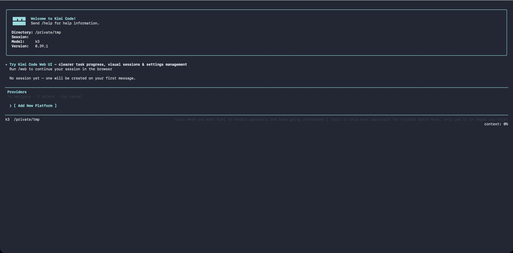

# Providers and models

Kimi Code CLI supports connecting to multiple LLM platforms simultaneously: one-click login via the Kimi Code managed service, connecting Claude with an Anthropic API key, or connecting third-party inference services via the OpenAI-compatible protocol. Each provider corresponds to a specific API protocol; models are declared on top of providers with their own name, context length, and capabilities. This page explains how to configure each type of provider in `config.toml`.

## Supported provider types

The `type` field in the `providers` table determines which protocol implementation to use:

| Type | Protocol | Typical use |
| --- | --- | --- |
| [`kimi`](#kimi) | OpenAI-compatible | Kimi Code managed service, Kimi Platform API key |
| [`anthropic`](#anthropic) | Anthropic Messages | Claude model family |
| [`openai`](#openai) | OpenAI Chat Completions | OpenAI and compatible services, DeepSeek, Qwen, etc. |
| [`openrouter`](#openrouter) | OpenAI Chat Completions | OpenRouter routing and structured reasoning |
| [`openai_responses`](#openai_responses) | OpenAI Responses API | OpenAI's newer Responses interface |
| [`google-genai`](#google-genai) | Google GenAI | Gemini API |
| [`vertexai`](#vertexai) | Google GenAI on Vertex | Google Cloud Vertex AI |

All providers communicate with models in streaming mode by default. Capabilities such as thinking, vision, and tool use are matched automatically by model name prefix, so you typically do not need to declare them manually.

**Credential priority**: `api_key` or `api_key_env` (mutually exclusive alternatives — set exactly one) > `[providers.<name>.env]` sub-table key (only when neither is present) > if all are absent, startup fails with an error. Except for the explicitly declared `api_key_env`, the CLI does not fall back to shell environment variables for credentials. See [Config overrides: provider credentials](./overrides.md#provider-credentials).

## `/provider` — interactive provider management

Prefer not to edit TOML by hand? Type `/provider` in the TUI to open the **provider manager**, where you can interactively add or remove providers.



The manager displays providers as a list of entries grouped by source. Navigation:

- ↑/↓ to move the cursor, ←/→ to page
- `d` to delete the current provider (with `[y/N]` confirmation)
- Press Enter on the `[ Add New Platform ]` row to add a new provider

Two paths when adding:

- **Known third-party provider**: fetches the model catalog from [models.dev](https://models.dev/), select a provider → enter an API key → select a default model. Vendors whose protocol the catalog does not declare (e.g. xai and other vendor-specific SDKs) are imported as OpenAI-compatible with a "guessed" note; when the catalog provides no usable endpoint, a base URL prompt appears first; proprietary protocols (Amazon Bedrock, Cohere) and unrecognized explicit protocols are refused. Deprecated and alpha-status models are excluded from the import list. If the public catalog is unreachable, the CLI falls back to a built-in snapshot of the catalog, so the import still works offline or in blocked networks
- **Custom registry (api.json)**: paste a custom registry URL and, for private registries, a Bearer token; the CLI automatically creates the `providers` / `models` entries. When a registry entry declares the `env` field (the name of the environment variable holding the API key), the CLI prints it as a hint — set `api_key_env` in `config.toml` yourself to use it. The binding is never automatic: the registry chooses both the variable name and the endpoint the credential is sent to, so it must not decide which of your secrets is read. For private registries the Bearer token itself is still stored as `source.apiKey` so the registry can be refetched on refresh. On later startup, providers from the same registry URL are refreshed together, so upstream provider additions, removals, and model metadata changes are synced.

  A registry model may also declare an `upgrade` object. `model` selects the replacement model in the same provider, `migration_markdown` supplies the explanation shown during migration (`{model_from}` and `{model_to}` in it are replaced with the model ids on import), and `retirement_at` is an optional RFC3339 timestamp or `null`. The field is stored on the corresponding model alias and returned by `GET /api/v1/models`, so clients can recover migration guidance whenever they reload the catalog. Refreshing syncs or removes this metadata and leaves the default model alone while the registry still lists it. When the registry drops the default model, the default moves to the `upgrade` target that model declared if the target still exists, keeping your thinking setting; otherwise the default and the thinking setting are cleared. Open sessions still using the dropped model switch to that target too, keeping their thinking level when the target supports it. To retire a model, declare `upgrade` on it first and keep it listed long enough for clients to refresh at least once, then remove it from the registry.

  On startup, the TUI prompts when the current model has a valid upgrade target, including after choosing a session to resume. The explanation is rendered as Markdown. The prompt waits until the editor is empty and no turn or dialog is active; if an approval or question interrupts it, it returns when the editor is idle again. Confirm with `Enter`; `Space` does not accept a migration. Accepting switches the model and keeps the current effort when the previous model supports thinking and the target supports that effort, otherwise the target's default effort is used; keeping the current model records the choice so that migration is not shown again. When the startup refresh finds that the registry dropped the default model, the TUI shows a warning and, if the current session uses that model, switches it to the replacement with the same effort rule, without asking.

  Besides the automatic startup refresh, you can trigger the same refresh manually at runtime: `/provider refresh` re-fetches the model list of every provider, and `/provider refresh <providerId>` limits the refresh to a single provider. The command reports added and removed models per provider; a removed alias stops resolving for agents bound to it on their next turn, so removals are highlighted in the output.

  A registry provider entry may also declare optional `search_url` and `feedback_url` strings (stored as `search_url` and `feedback_url` on `[providers.<id>]`). When non-empty, `WebSearch` and `/feedback` for models under that provider send requests to those URLs authenticated with the provider's credential instead of requiring a managed Kimi Code OAuth login; omitting or removing a field disables it on the next refresh.

  These fields are a Kimi registry extension, not part of the models.dev schema:

  ```json
  {
    "search_url": "https://registry.example.com/v1/search",
    "feedback_url": "https://registry.example.com/v1/feedback",
    "models": {
      "current-model": {
        "id": "current-model-id",
        "upgrade": {
          "model": "new-model-id",
          "migration_markdown": "We recommend switching from {model_from} to {model_to}.",
          "retirement_at": "2027-01-01T00:00:00Z"
        }
      }
    }
  }
  ```

::: warning
Kimi Code OAuth managed accounts logged in via `/login` do not appear in `/provider`. Use `/login` and `/logout` to manage them.
:::

The same operations are also available in non-interactive environments via the shell command: [`kimi provider`](../reference/kimi-command.md#kimi-provider).

## `kimi`

For connecting to Moonshot AI's OpenAI-compatible interface, including the Kimi Code managed service and Kimi Platform API keys.

- Default `base_url`: `https://api.moonshot.ai/v1`
- Credential key names: `KIMI_API_KEY`, `KIMI_BASE_URL`
- Additional capability: supports video upload

```toml
[providers.kimi]
type = "kimi"
base_url = "https://api.moonshot.ai/v1"
api_key = "sk-xxxxx"
```

> When using the Kimi Code managed service, running `/login` automatically configures `base_url` and credentials, so no manual setup is needed.

## `anthropic`

For connecting to the Claude API. Standard Claude models automatically enable vision, tool use, and Thinking (where supported); custom or uncovered models need `capabilities` declared explicitly on `[models.<alias>]`.

- Default `base_url`: follows Anthropic SDK default
- Credential key names: `ANTHROPIC_API_KEY`, `ANTHROPIC_BASE_URL`
- Default `max_tokens`: inferred per model. To override, set `max_output_size` on the model alias

```toml
[providers.anthropic]
type = "anthropic"
api_key = "sk-ant-xxxxx"

[models."claude-opus-4-7"]
provider = "anthropic"
model = "claude-opus-4-7"
max_context_size = 200000
# max_output_size = 32000  # optional; omit to use the model-inferred default
```

## `openai`

For connecting to the OpenAI Chat Completions protocol, as well as any third-party service compatible with that protocol (override `base_url` as needed).

Third-party reasoning models (DeepSeek, Qwen, One API, etc.) work out of the box: the CLI automatically handles the `reasoning_content` field and `reasoning_effort` injection. If your gateway returns reasoning content under a non-standard field name, set `reasoning_key` on the model alias to override.

- Default `base_url`: `https://api.openai.com/v1`
- Credential key names: `OPENAI_API_KEY`, `OPENAI_BASE_URL`

```toml
[providers.openai]
type = "openai"
base_url = "https://api.openai.com/v1"
api_key = "sk-xxxxx"
```

## `openrouter`

Use `type = "openrouter"` with the `openai` model protocol for OpenRouter Chat Completions. This provider preserves structured reasoning, including signed or encrypted state, across tool calls and session resume. It uses the existing OpenAI transport with OpenRouter-specific request options.

Set `OPENROUTER_API_KEY` in the environment, then add these aliases to `config.toml`. Each alias selects one upstream route with fallbacks disabled; these are explicit example choices, not provider defaults.

```toml
default_model = "gemini"

[providers.openrouter]
type = "openrouter"
base_url = "https://openrouter.ai/api/v1"
api_key_env = "OPENROUTER_API_KEY"
model_source = "static"

[models.gemini]
provider = "openrouter"
model = "google/gemini-4-hydrogen"
protocol = "openai"
max_context_size = 1048576
capabilities = ["thinking", "always_thinking", "tool_use"]

[models.gemini.openrouter.reasoning]
enabled = true

[models.gemini.openrouter.provider]
only = ["google-ai-studio/flex"]
allow_fallbacks = false

[models.muse]
provider = "openrouter"
model = "meta/muse-ember"
protocol = "openai"
max_context_size = 1048576
capabilities = ["thinking", "always_thinking", "tool_use"]

[models.muse.openrouter.provider]
only = ["google-vertex/global"]
allow_fallbacks = false

[models.deepseek_do]
provider = "openrouter"
model = "deepseek/deepseek-v4.1-flash-1017"
protocol = "openai"
max_context_size = 1048576
capabilities = ["thinking", "always_thinking", "tool_use"]

[models.deepseek_do.openrouter.reasoning]
enabled = true

[models.deepseek_do.openrouter.provider]
only = ["digitalocean"]
allow_fallbacks = false

[models.deepseek_baseten]
provider = "openrouter"
model = "deepseek/deepseek-v4.1-flash-1017"
protocol = "openai"
max_context_size = 1048576
capabilities = ["thinking", "always_thinking", "tool_use"]

[models.deepseek_baseten.openrouter.reasoning]
enabled = true

[models.deepseek_baseten.openrouter.provider]
only = ["baseten/fast"]
allow_fallbacks = false
```

Run `kimi --model gemini`, `kimi --model muse`, `kimi --model deepseek_do`, or `kimi --model deepseek_baseten`. Validate the file with `kimi doctor config` before starting a session.

Output budgets and thinking effort belong to the ordinary [model configuration](./config-files.md#models). Set `max_output_size` only when an output cap is wanted; use the model's `support_efforts`, `default_effort`, and active Thinking setting for effort. The OpenRouter provider adds no fixed effort or output cap for any model.

Optional `[models.<alias>.openrouter.reasoning]` accepts `enabled`, `effort`, `max_tokens`, and `exclude`. When this object is present, it takes precedence as a whole over the active generic Thinking setting, including when it contains only `enabled` or `exclude`. Omit it to use ordinary model thinking controls, as in the Muse alias above. Its `max_tokens` is a reasoning-token budget, distinct from the model's total output budget. The explicit fields are forwarded to OpenRouter; endpoint support still applies.

`[models.<alias>.openrouter.provider]` accepts `only`, `order`, `ignore`, `allow_fallbacks`, and `require_parameters`. Omitted fields retain OpenRouter's defaults. Provider catalog import uses models.dev metadata; it does not import native OpenRouter endpoint reasoning metadata. Keep model capabilities and supported efforts aligned with the selected endpoint.

When retained OpenRouter reasoning belongs to a different model or provider type, the CLI rejects the request before sending it and asks for a new session. Existing history is preserved. A changed upstream route for the same OpenRouter model is not covered by this identity check; use a new session when changing routes whose reasoning compatibility is unknown.

## `openai_responses`

Corresponds to OpenAI's newer Responses API, always operating in streaming mode. Configuration is the same as `openai`.

- Default `base_url`: `https://api.openai.com/v1`
- Credential key names: `OPENAI_API_KEY`, `OPENAI_BASE_URL`

```toml
[providers.openai-responses]
type = "openai_responses"
base_url = "https://api.openai.com/v1"
api_key = "sk-xxxxx"
```

### Sign in with ChatGPT

Run `/login`, select **Sign in with ChatGPT**, and approve use of an eligible ChatGPT plan in the browser on the same machine. Use `/model` to select a model from your account's catalog. To switch accounts or renew access, select a saved account in `/login`. Select ChatGPT in `/logout` to end the active session. To disable sign-in, start Kimi Code CLI with `KIMI_CODE_EXPERIMENTAL_CHATGPT_SIGN_IN=0`.

For terminal commands, see [`kimi login`](../reference/kimi-command.md#kimi-login). Review plan limits and app access in [ChatGPT Settings → Usage](https://chatgpt.com/settings/usage).

Switching accounts updates the ChatGPT model list. Future requests for ChatGPT models, including requests in existing Kimi sessions, use the selected account.

In `/model`, use the left and right arrow keys to choose a reasoning effort. After selecting the model, request **Normal**, **Fast**, or **Ultrafast** from the tiers available to the account and model. OpenAI may process the request at a different tier. Use `Alt-S` on the model to apply the selection to the current session. Run `/provider refresh chatgpt` to reload available options.

## `google-genai`

For connecting directly to the Google Gemini API. Thinking, vision, and multimodal capabilities are auto-detected by model name.

- Credential key name: `GOOGLE_API_KEY`

```toml
[providers.gemini]
type = "google-genai"
api_key = "xxxxx"
```

To route through a Gemini-compatible proxy or gateway, set `base_url` (or the `GOOGLE_GEMINI_BASE_URL` env var); when omitted, the SDK default `https://generativelanguage.googleapis.com` is used.

A trailing `/v1beta` is stripped before the request. The SDK then appends the API version and path itself (e.g. `/v1beta/models/<model>:generateContent`).

```toml
[providers.gemini]
type = "google-genai"
api_key = "xxxxx"
base_url = "https://your-gateway.example"
```

## `vertexai`

Shares the same implementation as `google-genai`; setting `type = "vertexai"` switches to the Vertex AI access path.

Authentication follows the standard Google Cloud ADC flow (`gcloud auth application-default login` or a `GOOGLE_APPLICATION_CREDENTIALS` service account JSON); this part is unrelated to Kimi Code. **The project ID and region must be written in the `[providers.vertexai.env]` sub-table**. Simply `export GOOGLE_CLOUD_PROJECT` in the shell will not be read by the CLI.

```toml
[providers.vertexai]
type = "vertexai"

[providers.vertexai.env]
GOOGLE_CLOUD_PROJECT = "my-gcp-project"
GOOGLE_CLOUD_LOCATION = "us-central1"
```

```sh
gcloud auth application-default login   # one-time authentication
kimi
```

To route Vertex requests through a custom (e.g. proxied) endpoint, set `base_url` (or the `GOOGLE_VERTEX_BASE_URL` env var); when omitted, the SDK default regional `*-aiplatform.googleapis.com` host is used. A trailing `/v1beta1` is stripped before the request. The SDK appends `/v1beta1/publishers/google/models/…` itself.

## OAuth and credential injection

The Kimi Code managed service uses OAuth rather than static API keys. After running `/login`, the built-in authentication toolchain automatically writes and refreshes credentials, so no manual configuration is needed in `config.toml` for this.

## Next steps

- [Configuration files](./config-files.md) — full field reference for the `providers` and `models` tables
- [Config overrides](./overrides.md) — credential resolution priority rules for providers
- [Environment variables](./env-vars.md) — credential key names per provider type
