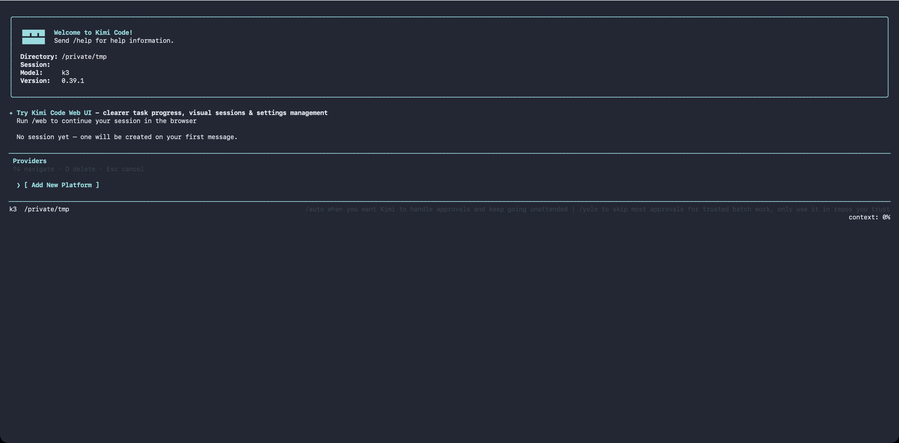

# 平台与模型

Kimi Code CLI 支持同时接入多家模型供应商服务，模型在供应商之上声明自己的名称、上下文长度和能力。本页介绍如何在 `config.toml` 里配置各种供应商。

## 支持的供应商类型

`providers` 表里的 `type` 字段决定使用哪种协议实现：

| 类型 | 协议 | 典型用途 |
| --- | --- | --- |
| [`kimi`](#kimi) | OpenAI 兼容 | Kimi Code 托管服务、Kimi Platform API 密钥 |
| [`anthropic`](#anthropic) | Anthropic Messages | Claude 系列模型 |
| [`openai`](#openai) | OpenAI Chat Completions | OpenAI 及兼容服务、DeepSeek、Qwen 等 |
| [`openrouter`](#openrouter) | OpenAI Chat Completions | OpenRouter 路由和结构化推理 |
| [`openai_responses`](#openai_responses) | OpenAI Responses API | OpenAI 较新的 Responses 接口 |
| [`google-genai`](#google-genai) | Google GenAI | Gemini API |
| [`vertexai`](#vertexai) | Google GenAI on Vertex | Google Cloud Vertex AI |

所有供应商默认以流式方式与模型交互。thinking、视觉、工具调用等能力按模型名前缀自动匹配，通常不需要手动声明。

**凭证优先级**：`api_key` 或 `api_key_env`（互斥替代项，只能设置其中一个）> `[providers.<name>.env]` 子表键（两者都不存在时才读）> 全部缺失时启动报错。除显式声明的 `api_key_env` 外，CLI 不会从 shell 环境变量自动取凭证，详见[配置覆盖：供应商凭证](./overrides.md#供应商凭证)。

## `/provider` — 交互式供应商管理

不想手动编辑 TOML？在 TUI 里输入 `/provider` 打开**供应商管理器**，可以以交互方式添加或删除供应商。



管理器按来源把供应商显示为一行行条目。操作方式：

- ↑/↓ 移动光标，←/→ 翻页
- `d` 键删除当前供应商（有 `[y/N]` 确认）
- 在 `[ Add New Platform ]` 行按 Enter 添加新供应商

添加时有两条路径：

- **Known third-party provider**：从 [models.dev](https://models.dev/) 拉取模型目录，选供应商 → 输入 API 密钥 → 选默认模型。目录未声明协议类型的供应商（如 xai 这类厂商专用 SDK）会按 OpenAI 兼容协议导入并显示 "guessed" 提示；目录没有可用端点时会先弹出 base URL 输入框；Amazon Bedrock / Cohere 等专有协议和无法识别的显式协议会被拒绝导入。已下线（deprecated）和 alpha 状态的模型不会出现在导入列表中。如果公共目录不可达，CLI 会回退到内置目录快照，离线或网络受限环境下也能完成导入
- **Custom registry (api.json)**：粘贴自定义 registry 地址，私有 registry 再附上 Bearer token，CLI 自动创建 `providers` / `models` 条目。当 registry 条目声明了 `env` 字段（存放 API 密钥的环境变量名）时，CLI 会把它作为提示打印出来——想用就在 `config.toml` 里自己设置 `api_key_env`。绑定永远不会自动发生：registry 既决定变量名、又决定凭证发往的端点，不能由它来选择读取你的哪份密钥。对私有 registry，Bearer token 本身仍会存为 `source.apiKey`，供刷新时重新拉取。后续启动时，同一个 registry 地址下的供应商会一起刷新，因此上游新增、删除供应商以及模型元数据变化都会同步。

  registry 中的模型还可以声明 `upgrade` 对象。`model` 选择同一供应商下的替代模型，`migration_markdown` 提供迁移说明（其中的 `{model_from}` 和 `{model_to}` 会在导入时替换为模型 ID），`retirement_at` 是可选的 RFC3339 时间戳或 `null`。该字段会保存在对应的模型别名上，并通过 `GET /api/v1/models` 返回，客户端每次重新读取模型目录后都能恢复迁移提示。刷新会同步或移除这些元数据；只要默认模型仍在 registry 中，刷新就不会修改它。registry 删除默认模型时，如果该模型此前声明的 `upgrade` 目标仍然存在，默认模型会切换到该目标并保留 Thinking 设置；否则默认模型与 Thinking 设置一并清空。仍在使用被删除模型的已打开会话也会切换到该目标，目标支持时保留各自的 Thinking 档位。因此下线模型时，应先给它声明 `upgrade` 并保留一段过渡期，让客户端至少刷新一次，再从 registry 中删除。

  启动时，如果当前模型存在有效的升级目标，TUI 会显示迁移提示，包括从会话列表选择并恢复会话之后。迁移说明以 Markdown 渲染。提示会等待输入框为空，且没有正在运行的轮次或打开的对话框；如果被审批或提问打断，会在输入框再次空闲后重新显示。按 `Enter` 确认；空格不会接受迁移。接受后会切换模型，并在原模型支持 Thinking 且目标模型支持当前档位时沿用当前档位，否则使用目标模型的默认档位；选择保留当前模型则会记录该决定，之后不再提示同一次迁移。如果启动刷新发现 registry 已删除默认模型，TUI 会显示警告；当前会话正在使用该模型时，会按同样的档位规则直接切换到替代模型，不再询问。

  除了启动时自动刷新，你也可以在运行时手动触发同样的刷新：`/provider refresh` 重新拉取所有供应商的模型列表，`/provider refresh <providerId>` 只刷新指定供应商。命令会按供应商汇报新增和下架的模型；被下架的 alias 对绑定它的 agent 从下一轮起不再可解析，因此下架项会在输出中高亮标出。

  registry 中的供应商条目还可以声明可选字符串字段 `search_url` 和 `feedback_url`（导入后存为 `[providers.<id>]` 下的 `search_url` 和 `feedback_url`）。字段非空时，该供应商下模型的 `WebSearch` 与 `/feedback` 会直接携带该供应商的凭证发往对应地址，无需登录托管的 Kimi Code OAuth 账号；省略或在上游移除字段后，下次刷新会自动清除。

  这些字段是 Kimi registry 的扩展，不属于 models.dev 的 schema：

  ```json
  {
    "search_url": "https://registry.example.com/v1/search",
    "feedback_url": "https://registry.example.com/v1/feedback",
    "models": {
      "current-model": {
        "id": "current-model-id",
        "upgrade": {
          "model": "new-model-id",
          "migration_markdown": "建议从 {model_from} 切换到 {model_to}。",
          "retirement_at": "2027-01-01T00:00:00Z"
        }
      }
    }
  }
  ```

::: warning
通过 `/login` 登录的 Kimi Code OAuth 托管账号不会在 `/provider` 里显示，请用 `/login` 和 `/logout` 管理。
:::

非交互环境下也可以用 shell 命令完成同样操作：[`kimi provider`](../reference/kimi-command.md#kimi-provider)。

## `kimi`

用于对接 Moonshot AI 的 OpenAI 兼容接口，包括 Kimi Code 托管服务和 Kimi Platform API 密钥。

- 默认 `base_url`：`https://api.moonshot.ai/v1`
- 凭证键名：`KIMI_API_KEY`、`KIMI_BASE_URL`
- 额外能力：支持视频上传

```toml
[providers.kimi]
type = "kimi"
base_url = "https://api.moonshot.ai/v1"
api_key = "sk-xxxxx"
```

> 使用 Kimi Code 托管服务时，`/login` 登录后会自动配置 `base_url` 和凭证，无需手动填写。

## `anthropic`

用于对接 Claude API。标准 Claude 模型自动启用视觉、工具调用及 Thinking（如支持）；自定义或未覆盖的模型需在 `[models.<alias>]` 里显式声明 `capabilities`。

- 默认 `base_url`：跟随 Anthropic SDK 默认值
- 凭证键名：`ANTHROPIC_API_KEY`、`ANTHROPIC_BASE_URL`
- 默认 `max_tokens`：按模型自动推断。如需覆盖，在模型别名上设 `max_output_size`

```toml
[providers.anthropic]
type = "anthropic"
api_key = "sk-ant-xxxxx"

[models."claude-opus-4-7"]
provider = "anthropic"
model = "claude-opus-4-7"
max_context_size = 200000
# max_output_size = 32000  # 可选，省略时使用模型推断的默认值
```

## `openai`

用于对接 OpenAI Chat Completions 协议，也可连接任何兼容该协议的第三方服务（覆盖 `base_url` 即可）。

第三方推理模型（DeepSeek、Qwen、One API 等）开箱即用：CLI 自动处理 `reasoning_content` 字段和 `reasoning_effort` 注入。如果你的网关用非标准字段名返回推理内容，在模型别名上设 `reasoning_key` 覆盖。

- 默认 `base_url`：`https://api.openai.com/v1`
- 凭证键名：`OPENAI_API_KEY`、`OPENAI_BASE_URL`

```toml
[providers.openai]
type = "openai"
base_url = "https://api.openai.com/v1"
api_key = "sk-xxxxx"
```

## `openrouter`

通过 `type = "openrouter"` 和模型的 `openai` 协议接入 OpenRouter Chat Completions。此供应商会在工具调用和会话恢复之间保留结构化推理，包括签名或加密状态。它沿用 OpenAI 传输实现，并支持 OpenRouter 专用请求选项。

在环境中设置 `OPENROUTER_API_KEY`，然后将以下别名加入 `config.toml`。每个别名指定一个上游路由并关闭回退；这些是示例中的显式选择，不是供应商默认值。

```toml
default_model = "gemini"

[providers.openrouter]
type = "openrouter"
base_url = "https://openrouter.ai/api/v1"
api_key_env = "OPENROUTER_API_KEY"
model_source = "static"

[models.gemini]
provider = "openrouter"
model = "google/gemini-4-hydrogen"
protocol = "openai"
max_context_size = 1048576
capabilities = ["thinking", "always_thinking", "tool_use"]

[models.gemini.openrouter.reasoning]
enabled = true

[models.gemini.openrouter.provider]
only = ["google-ai-studio/flex"]
allow_fallbacks = false

[models.muse]
provider = "openrouter"
model = "meta/muse-ember"
protocol = "openai"
max_context_size = 1048576
capabilities = ["thinking", "always_thinking", "tool_use"]

[models.muse.openrouter.provider]
only = ["google-vertex/global"]
allow_fallbacks = false

[models.deepseek_do]
provider = "openrouter"
model = "deepseek/deepseek-v4.1-flash-1017"
protocol = "openai"
max_context_size = 1048576
capabilities = ["thinking", "always_thinking", "tool_use"]

[models.deepseek_do.openrouter.reasoning]
enabled = true

[models.deepseek_do.openrouter.provider]
only = ["digitalocean"]
allow_fallbacks = false

[models.deepseek_baseten]
provider = "openrouter"
model = "deepseek/deepseek-v4.1-flash-1017"
protocol = "openai"
max_context_size = 1048576
capabilities = ["thinking", "always_thinking", "tool_use"]

[models.deepseek_baseten.openrouter.reasoning]
enabled = true

[models.deepseek_baseten.openrouter.provider]
only = ["baseten/fast"]
allow_fallbacks = false
```

运行 `kimi --model gemini`、`kimi --model muse`、`kimi --model deepseek_do` 或 `kimi --model deepseek_baseten`。开始会话前可用 `kimi doctor config` 验证文件。

输出预算和推理强度由普通[模型配置](./config-files.md#models)管理。需要限制输出时才设置 `max_output_size`；推理强度使用模型的 `support_efforts`、`default_effort` 和当前 Thinking 设置。OpenRouter 供应商不会为任何模型添加固定强度或输出上限。

可选的 `[models.<alias>.openrouter.reasoning]` 接受 `enabled`、`effort`、`max_tokens` 和 `exclude`。只要此对象存在，就会整体优先于当前通用 Thinking 设置，即使其中只有 `enabled` 或 `exclude`。省略它即可使用普通模型推理控制，如上面的 Muse 别名。这里的 `max_tokens` 是推理 token 预算，与模型的总输出预算不同。显式字段会传给 OpenRouter，具体支持仍取决于所选端点。

`[models.<alias>.openrouter.provider]` 接受 `only`、`order`、`ignore`、`allow_fallbacks` 和 `require_parameters`。未配置的字段保留 OpenRouter 的默认行为。供应商目录导入使用 models.dev 元数据，不会导入 OpenRouter 原生端点的推理元数据。模型能力和支持的推理强度应与所选端点一致。

如果保留的 OpenRouter 推理属于其他模型或供应商类型，CLI 会在发送前拒绝请求，并提示创建新会话。已有历史会保留。相同 OpenRouter 模型的上游路由变化不在此身份检查范围内；切换到推理兼容性未知的路由时，应创建新会话。

## `openai_responses`

对应 OpenAI 较新的 Responses API，始终以流式方式工作。配置方式与 `openai` 相同。

- 默认 `base_url`：`https://api.openai.com/v1`
- 凭证键名：`OPENAI_API_KEY`、`OPENAI_BASE_URL`

```toml
[providers.openai-responses]
type = "openai_responses"
base_url = "https://api.openai.com/v1"
api_key = "sk-xxxxx"
```

### Sign in with ChatGPT

要使用符合条件的 ChatGPT 订阅，请设置 `KIMI_CODE_EXPERIMENTAL_CHATGPT_SIGN_IN=1` 后启动 Kimi Code CLI。运行 `/login`，选择 **Sign in with ChatGPT**，在同一台设备的浏览器中授权使用订阅。使用 `/model` 从账号的模型目录中选择模型。切换账号或续期时，在 `/login` 中选择已保存的账号。退出当前会话时，在 `/logout` 中选择 ChatGPT。

终端用法见 [`kimi login`](../reference/kimi-command.md#kimi-login)。订阅限额和应用授权可在 [ChatGPT 设置 → 用量](https://chatgpt.com/settings/usage) 中查看。

切换账号会更新 ChatGPT 模型列表。后续的 ChatGPT 模型请求会使用所选账号，包括 Kimi 现有会话发出的请求。

## `google-genai`

用于直连 Google Gemini API。thinking、视觉及多模态能力按模型名自动识别。

- 凭证键名：`GOOGLE_API_KEY`

```toml
[providers.gemini]
type = "google-genai"
api_key = "xxxxx"
```

如需经由兼容 Gemini 协议的代理/网关访问，可设置 `base_url`（或 `GOOGLE_GEMINI_BASE_URL` 环境变量）；不填时使用 SDK 默认地址 `https://generativelanguage.googleapis.com`。

结尾的 `/v1beta` 会在请求前去掉。SDK 随后自行追加 API 版本与路径（如 `/v1beta/models/<model>:generateContent`）。

```toml
[providers.gemini]
type = "google-genai"
api_key = "xxxxx"
base_url = "https://your-gateway.example"
```

## `vertexai`

与 `google-genai` 共用实现，`type = "vertexai"` 时切换到 Vertex AI 访问路径。

认证走 Google Cloud 标准 ADC 流程（`gcloud auth application-default login` 或 `GOOGLE_APPLICATION_CREDENTIALS` 服务账号 JSON），这部分与 Kimi Code 无关。**项目 ID 和区域必须写在 `[providers.vertexai.env]` 子表里**。直接在 shell 里 `export GOOGLE_CLOUD_PROJECT` 不会被 CLI 读取。

```toml
[providers.vertexai]
type = "vertexai"

[providers.vertexai.env]
GOOGLE_CLOUD_PROJECT = "my-gcp-project"
GOOGLE_CLOUD_LOCATION = "us-central1"
```

```sh
gcloud auth application-default login   # 一次性完成认证
kimi
```

如需让 Vertex 请求走自定义（如代理）端点，可设置 `base_url`（或 `GOOGLE_VERTEX_BASE_URL` 环境变量）；不填时使用 SDK 默认的区域化 `*-aiplatform.googleapis.com` 地址。结尾的 `/v1beta1` 会在请求前去掉。SDK 随后自行追加 `/v1beta1/publishers/google/models/…`。


## 下一步

- [配置文件](./config-files.md) — `providers` 和 `models` 表的完整字段参考
- [配置覆盖](./overrides.md) — 供应商凭证的解析优先级规则
- [环境变量](./env-vars.md) — 各供应商对应的凭证键名列表
